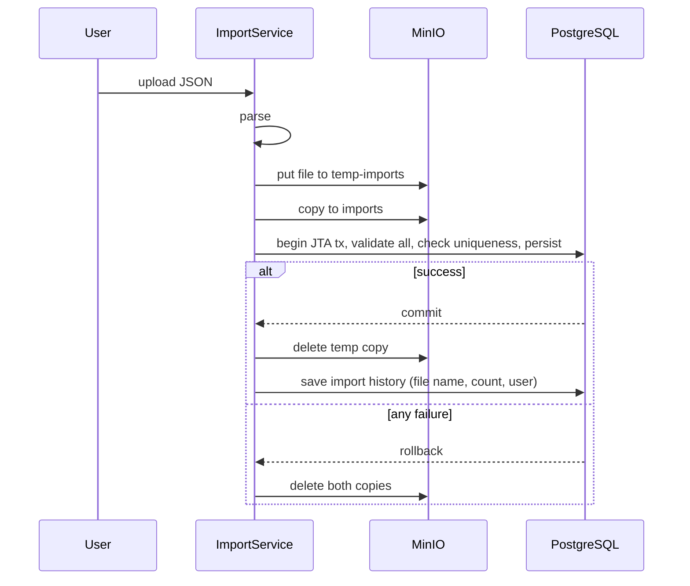

# Marines Registry

A multi-user registry of Space Marines and their Chapters on Jakarta EE and WildFly. Users manage
their own records in a PrimeFaces UI, administrators approve new accounts, and data can be bulk
imported from JSON files. The interesting part is the import: it validates the whole file, checks
uniqueness across the file and the database, writes everything in one transaction, and keeps the
original file in MinIO, so the database and the object storage never disagree about what was
imported.

**Stack:** Java 11 · Jakarta EE 10 (JSF, CDI, EJB, JPA, JTA, Bean Validation, Jakarta Security) · WildFly · Hibernate 6 · PrimeFaces 14 · OmniFaces · PostgreSQL · MinIO · JMeter · Maven

## Features

- **Accounts and roles.** Registration puts a user in the `NEW` role until an administrator
  approves it. A `USER` edits only the objects they created. An `ADMIN` can edit any object and
  delete others' objects only when the owner allowed it. Authentication goes through a custom
  `IdentityStore` on Elytron with SHA-512 password hashes.
- **CRUD with live tables.** Space Marines with coordinates, weapon and category, linked to
  Chapters. Tables support filtering and sorting and refresh every 5 seconds, so changes made by
  other users show up without reloading the page.
- **Concurrent edits.** Each update compares the stored record with the state the user started
  editing. If someone else changed or deleted it in the meantime, the update is rejected with a
  clear message instead of silently overwriting their work.
- **Database functions.** Aggregates and special queries (total health, marines below a health
  threshold, unique loyalty values) run as PL/pgSQL functions called through native queries.
- **Import and export.** JSON import of Chapters or Space Marines together with their Chapters,
  JSON export of the current data, and an import history with who, when, how many objects and a
  link to the original file.

## How the import stays consistent



- **One transaction for the whole file.** `TransactionalImportService` uses bean-managed
  transactions through `UserTransaction` with a timeout. Importing marines starts the transaction
  and imports their Chapters inside it, so a bad marine rolls back the Chapters too.
- **All-or-nothing validation.** Bean Validation runs on every object before anything is written.
  Duplicates are rejected both inside the file and against existing rows.
- **Compensation for the object storage.** MinIO is not part of the JTA transaction, so the file is
  written to a temporary bucket first and removed from both buckets if the database part fails.
  A file in `imports` therefore always matches a successful import.

## Load testing

`crud_tests.jmx` runs 7 concurrent users through login, create, update, delete and import of
Chapters, with a synchronizing timer so requests hit the server at the same moment. It checks that
uniqueness rules and conflict detection hold under real concurrency, not only in single-user tests.

## Run locally

```bash
docker run -d -p 9000:9000 -p 9001:9001 minio/minio server /data --console-address ":9001"
# PostgreSQL: create the database and run extensions/functions.sql
# WildFly: add the PostgreSQL module (extensions/postgresql-module.xml) and run extensions/configure-elytron.cli
mvn package
cp target/*.war $WILDFLY_HOME/standalone/deployments/
```

Sample data: `chapters_data.json`, `space_marines_data.json`.

## Earlier stages

[itmo-is-lab1](https://github.com/foliageh/itmo-is-lab1) has the CRUD, roles and live tables,
[itmo-is-lab2](https://github.com/foliageh/itmo-is-lab2) adds import, transactions and JMeter tests.
This repository contains the full history.

---
Built as coursework for the Information Systems course at ITMO University, 2024–2025.
